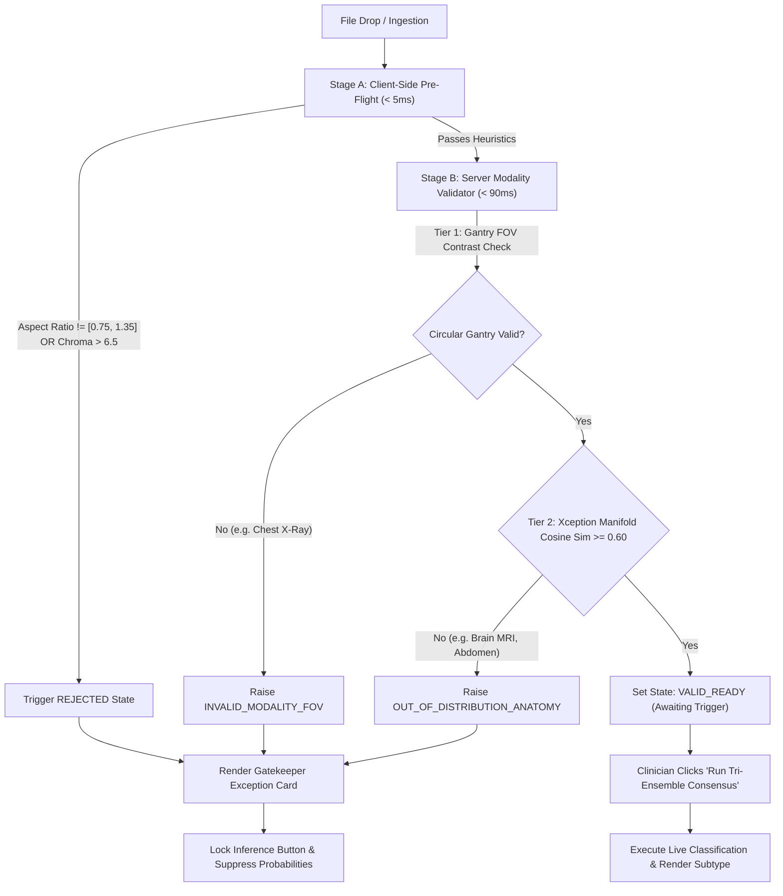

# PulmoVision AI (PulmoAI) — Frontend Comprehensive Technical Report

**Project Name:** PulmoVision AI / PulmoAI  
**Repository:** `Tech-Arch-Warriors`  
**Application Type:** Next.js Clinical Radiology & AI Diagnostic Suite  
**Target Domain:** Pulmonary CT Scan Classification, Non-Small Cell Lung Cancer (NSCLC) Subtyping & Explainable AI (XAI)  
**Date of Report:** November 24, 2026  
**Document Status:** Complete Frontend Reference Manual & Architectural Specification  

---

## Table of Contents
1. [Executive Summary & Clinical Vision](#1-executive-summary--clinical-vision)
2. [Technology Stack & Core Dependencies](#2-technology-stack--core-dependencies)
3. [Architecture & Complete Source Directory Tree](#3-architecture--complete-source-directory-tree)
4. [Design System & UI/UX Philosophy](#4-design-system--uiux-philosophy)
   - [4.1 Color Architecture & Design Tokens](#41-color-architecture--design-tokens)
   - [4.2 The "Prominent Border" & Wave Texture Standard](#42-the-prominent-border--wave-texture-standard)
   - [4.3 Typography Hierarchy & Contrast Standards](#43-typography-hierarchy--contrast-standards)
5. [Page Routing & Section Compositions](#5-page-routing--section-compositions)
6. [Component Catalog & Deep Technical Specifications](#6-component-catalog--deep-technical-specifications)
   - [6.1 AppNavbar & NavigationDrawer](#61-appnavbar--navigationdrawer)
   - [6.2 HeroSection & DarkVeil WebGL Visualizer](#62-herosection--darkveil-webgl-visualizer)
   - [6.3 HeroOrbitalVisualizer (Continuous Multi-Orbital System)](#63-heroorbitalvisualizer-continuous-multi-orbital-system)
   - [6.4 DiagnosticStudio (Clinical Radiology Workspace)](#64-diagnosticstudio-clinical-radiology-workspace)
   - [6.5 BenchmarksView (KPIs, Confusion Matrix & Evolution)](#65-benchmarksview-kpis-confusion-matrix--evolution)
   - [6.6 PathologyView (4-Class Pulmonary Pathology Guide)](#66-pathologyview-4-class-pulmonary-pathology-guide)
   - [6.7 ArchitectureView (Tri-Ensemble Engineering Explorer)](#67-architectureview-tri-ensemble-engineering-explorer)
   - [6.8 ReportModal (Clinical Findings Report Generator)](#68-reportmodal-clinical-findings-report-generator)
   - [6.9 AuthModal & Clinician Profile Management](#69-authmodal--clinician-profile-management)
7. [Multi-Tier Out-of-Distribution (OOD) Modality Gatekeeper](#7-multi-tier-out-of-distribution-ood-modality-gatekeeper)
   - [7.1 Client-Side Pre-Flight Check (< 5ms)](#71-client-side-pre-flight-check--5ms)
   - [7.2 Server-Side 2-Tier Modality Interceptor](#72-server-side-2-tier-modality-interceptor)
   - [7.3 Diagnostic Gatekeeper Exception Card](#73-diagnostic-gatekeeper-exception-card)
   - [7.4 Strict Inference State Machine & Manual Consensus Trigger](#74-strict-inference-state-machine--manual-consensus-trigger)
8. [Radiology Tools, Image Processing & Explainable AI (XAI)](#8-radiology-tools-image-processing--explainable-ai-xai)
9. [Client-Side State Management & Backend Integration](#9-client-side-state-management--backend-integration)
10. [Responsive Design Matrix & Multi-Device Optimization](#10-responsive-design-matrix--multi-device-optimization)
11. [Visual Polish & Recent Frontend Implementations](#11-visual-polish--recent-frontend-implementations)
12. [Setup, Build & Developer Operations](#12-setup-build--developer-operations)

---

## 1. Executive Summary & Clinical Vision

**PulmoVision AI (PulmoAI)** is a specialized, web-based diagnostic radiology platform engineered to classify high-resolution thoracic Computed Tomography (CT) scans across four distinct clinical categories:
1. **Adenocarcinoma (Adeno)** — Peripheral glandular Non-Small Cell Lung Cancer (NSCLC).
2. **Squamous Cell Carcinoma (Squamous)** — Central cavitating bronchial NSCLC.
3. **Large Cell Carcinoma (Large Cell)** — Undifferentiated, highly aggressive NSCLC.
4. **Normal Healthy Lung** — Non-malignant pulmonary parenchyma.

The platform was built from the ground up to solve the critical "black-box" dilemma and the out-of-distribution vulnerability in medical machine learning. Rather than simply returning a raw probability number or allowing non-CT images to trigger false-positive diagnoses, the PulmoAI frontend delivers:
- **Multi-Tier Out-of-Distribution (OOD) Modality Gatekeeping**: Dual-stage interception (HTML5 Canvas pre-flight + deep feature manifold validation) executing in `< 95ms` that intercepts color photos, non-axial slices, brain MRIs, and X-rays before classification can run.
- **Controlled Manual Consensus Triggering**: Inference is never executed automatically upon scan attachment; clinicians inspect the validated slice in the viewport and explicitly engage the **Tri-Ensemble Consensus Engine**.
- **Interactive Multi-Model Consensus**: Real-time inspection of three specialized neural backbones (**DenseNet121** [60%], **EfficientNetV2-S** [30%], and **Xception** [10%]).
- **Explainable AI (Grad-CAM)**: High-resolution heatmap overlays that highlight exact spatial activations and nodular regions driving diagnostic decisions.
- **Radiology Workspace Suite**: Real-time Hounsfield Unit (HU) windowing (Standard, Lung, Mediastinal), CLAHE contrast equalization, digital zooming/panning, crosshairs, and grayscale inversion.
- **Audit-Ready Clinical Documentation**: Instant generation of standardized, printable/exportable clinical findings reports signed with clinician credentials.

---

## 2. Technology Stack & Core Dependencies

The frontend is built upon a modern, bleeding-edge React and Next.js architecture designed for ultra-low latency, strict type safety, and zero external UI library bloat.

| Layer | Technology | Version | Purpose |
| :--- | :--- | :--- | :--- |
| **Framework** | Next.js (App Router) | `16.3.8` | Server/Client components, dynamic routing, API proxying |
| **Core UI Library** | React / React DOM | `19.2.8` | Component rendering, concurrent UI transitions |
| **Language** | TypeScript | `^5.0` | Strict end-to-end type safety, medical domain interfaces |
| **Graphics & Shaders** | WebGL / Custom Canvas 2D | Native | DarkVeil organic background shader, interactive CT canvas |
| **Iconography** | Custom SVG Component Suite | Native | Lightweight, medical-specific vector iconography |
| **Styling** | Pure Modular CSS + CSS Variables | Native | Zero-runtime CSS design system, responsive media queries |
| **Linting & Code Quality** | ESLint + eslint-config-next | `^9.0` | Static analysis, accessibility, performance linting |

> [!NOTE]
> The project purposefully avoids heavy UI component dependencies (such as Tailwind, Material UI, or Radix). All styling is powered by a high-performance, centralized design system in `globals.css` that provides instantaneous rendering, fluid hardware-accelerated animations, and granular control over every single pixel.

---

## 3. Architecture & Complete Source Directory Tree

The frontend repository is structured within `Tech-Arch-Warriors/frontend` following Next.js App Router conventions:

```text
Tech-Arch-Warriors/frontend/
├── package.json
├── tsconfig.json
├── next.config.mjs
├── public/
│   ├── favicon.ico
│   ├── favicon.png
│   ├── logo.png / logo.jpg
│   ├── logo_full.png / logo_full.jpg
│   ├── lungs_bg.png
│   ├── navbar-texture.png
│   ├── wave-pattern.png / wave-pattern.jpg   # Signature turquoise wave background texture
│   ├── hex-pattern.png / hex-pattern.jpg     # Biotech honeycomb pattern
│   ├── hero_ct_scan.png
│   ├── assets/
│   └── samples/
│       ├── adenocarcinoma.png
│       ├── squamous_cell.png
│       ├── large_cell.png
│       └── normal_lung.png
└── src/
    ├── app/
    │   ├── favicon.ico
    │   ├── globals.css                       # Global Design System, Wave Theming & Modality Gatekeeper
    │   ├── layout.tsx                        # Root HTML shell, fonts, navbar & footer
    │   ├── page.tsx                          # Main SPA Landing & Diagnostic Workspace
    │   ├── analysis/
    │   │   └── page.tsx                      # Dedicated Analysis route
    │   ├── architecture/
    │   │   └── page.tsx                      # Dedicated Architecture Explorer route
    │   ├── benchmarks/
    │   │   └── page.tsx                      # Dedicated Benchmarks & Validation route
    │   ├── pathology/
    │   │   └── page.tsx                      # Dedicated 4-Class Pathology Reference route
    │   ├── settings/
    │   │   └── page.tsx                      # System Configuration & Preferences route
    │   └── api/
    │       ├── health/route.ts               # Next.js API endpoint proxying backend health
    │       ├── predict/route.ts              # Next.js API endpoint proxying CT inference
    │       └── validate/route.ts             # Next.js API endpoint proxying 2-Tier Gatekeeper
    ├── components/
    │   ├── AppNavbar.tsx                     # Sticky clinical navigation with profile popover
    │   ├── NavigationDrawer.tsx              # Responsive mobile slide-out navigation
    │   ├── HeroSection.tsx                   # Headline, clinical badges, stat cards
    │   ├── DiagnosticStudio.tsx              # Core interactive CT analysis workspace & Gatekeeper
    │   ├── BenchmarksView.tsx                # KPIs, Confusion Matrix & Evolution table
    │   ├── PathologyView.tsx                 # Comprehensive histological & imaging atlas
    │   ├── ArchitectureView.tsx              # Tri-Ensemble architecture visualizer
    │   ├── ReportModal.tsx                   # Clinical Diagnostic Findings Report modal
    │   ├── AuthModal.tsx                     # Clinician credential & profile management
    │   ├── Header.tsx                        # Secondary subpage navigation header
    │   ├── Icons.tsx                         # Dedicated medical & UI vector icon suite
    │   ├── OrbitingLungsShowcase.tsx         # Standalone 3D lungs showcase
    │   ├── CardNav/
    │   │   ├── CardNav.tsx                   # Floating quick-navigation pill
    │   │   └── CardNav.css                   # Micro-navigation styling
    │   ├── WarpText/
    │   │   ├── WarpText.tsx                  # Kinetic typography container
    │   │   └── WarpText.css                  # Perspective warp CSS transformations
    │   ├── DarkVeil/
    │   │   ├── DarkVeil.jsx                  # WebGL interactive fluid shader component
    │   │   └── DarkVeil.css                  # Canvas positioning & fallback styling
    │   ├── SideRays/
    │   │   ├── SideRays.jsx                  # Volumetric ambient lighting visualizer
    │   │   └── SideRays.css                  # Ambient ray positioning & animations
    │   └── HeroOrbitalVisualizer/
    │       ├── HeroOrbitalVisualizer.tsx     # 3D lung with continuous dual rotating card rings
    │       ├── HeroOrbitalVisualizer.css     # Continuous orbital animation & card styling
    │       ├── types.ts                      # Orbital node interfaces & coordinates
    │       └── index.ts                      # Barrel export
    ├── lib/
    │   ├── constants.ts                      # Sample scans, clinical profiles, benchmarks
    │   └── inferenceClient.ts                # Dual-mode client (FastAPI + Gatekeeper + Mock)
    └── types/
        └── medical.ts                        # Diagnostic types, validation errors, telemetry
```

---

## 4. Design System & UI/UX Philosophy

The user interface balances **clinical precision** with **cyber-clinical elegance**. It marries the focused, dark-themed ambiance of hospital radiology suites (`#050d16` and `#0f172a`) with the luminous clarity of electric cyan (`#02ffe0`) and fluid turquoise wave textures.

### 4.1 Color Architecture & Design Tokens
```css
:root {
  /* Core Clinical Palette */
  --bg-primary: #f8fafc;
  --bg-surface: #ffffff;
  --bg-surface-hover: #f1f5f9;
  --bg-dark: #0f172a;

  /* Clinical Accents & Tones */
  --color-teal-bright: #02ffe0;       /* Luminous Electric Cyan */
  --color-teal-primary: #00c2cb;      /* Clinical Brand Teal */
  --color-teal-deep: #005f50;         /* Contrast Border Teal */
  --color-navy-dark: #050d16;         /* Hero & Studio Dark Backdrop */
  --color-navy-card: #0b1a2d;         /* Card Background Navy */
  --color-mint-light: #d0fcf4;        /* Benchmark & Orbital Box Tint */
  --color-mint-accent: #a7ebd9;       /* Highlighted Row Tint */

  /* Diagnostic Severity & State Colors */
  --color-adeno: #0284c7;             /* Medical Blue */
  --color-squamous: #f59e0b;          /* Warning Amber */
  --color-large: #e11d48;             /* Critical Crimson */
  --color-normal: #10b981;            /* Healthy Emerald */
  --color-blocked: #f87171;           /* Gatekeeper Interception Coral */

  /* Structural Border Standards */
  --border-prominent: 2px solid #005f50;
  --border-prominent-cyan: 2px solid #02ffe0;
  --border-wave-btn: 3px solid #04615c;
  --border-subtle: #cbd5e1;
  --border-medium: #94a3b8;
}
```

### 4.2 The "Prominent Border" & Wave Texture Standard
Interactive primary buttons across the platform follow a proprietary **fluid turquoise wave aesthetic**:
- Background base of `#38cfb2` combined with `/wave-pattern.png?v=restore` using cover-sizing and quad-mirroring to eliminate visible seams.
- Framed in a bold `3px solid #04615c` border with dual box shadows (`0 8px 24px rgba(0, 0, 0, 0.55), inset 0 0 0 1px rgba(8, 116, 101, 0.5)`).
- Applied consistently to:
  - `.btn-hero-explore` (Explore PulmoAI)
  - `.btn-upload-attach` (Attach files)
  - `.btn-gatekeeper-primary` (Upload Valid Axial CT Scan)
  - `.btn-minimal-consensus` (Run Tri-Ensemble Consensus)
  - `.btn-report-print` (Print & Export Clinical Findings)

### 4.3 Typography Hierarchy & Contrast Standards
- **High-Contrast Button Typography**: Solid black text (`color: #000000 !important; font-weight: 900;`) coupled with downward directional drop-shadows (`text-shadow: 0 1.5px 3px rgba(0, 0, 0, 0.45), 0 3px 8px rgba(0, 0, 0, 0.2);`) ensures readability across varying background brightness.
- **Editorial Headlines**: `Playfair Display` serif font (`font-weight: 850`), delivering distinction to section titles.
- **Application Interface & Clinical Data**: `Plus Jakarta Sans` and `Inter` sans-serif fonts, engineered for optimal clarity without curvy distortion on high-DPI displays.
- **Radiologic Telemetry & Coordinates**: Monospace fonts (`var(--font-mono)`), used for coordinates, patient IDs, Hounsfield units, and gatekeeper latency metrics.

---

## 5. Page Routing & Section Compositions

| Route | Page Component | Key Modules Loaded | Purpose |
| :--- | :--- | :--- | :--- |
| `/` | `src/app/page.tsx` | `HeroSection`, `DiagnosticStudio`, `BenchmarksView`, `ReportModal` | Primary end-to-end clinical workflow |
| `/analysis` | `src/app/analysis/page.tsx` | `Header`, `DiagnosticStudio`, `AuthModal` | Dedicated fullscreen scan analysis workstation |
| `/architecture` | `src/app/architecture/page.tsx` | `Header`, `ArchitectureView`, `AuthModal` | Comprehensive model architecture breakdown |
| `/benchmarks` | `src/app/benchmarks/page.tsx` | `Header`, `BenchmarksView`, `AuthModal` | Validation benchmark metrics & confusion matrix |
| `/pathology` | `src/app/pathology/page.tsx` | `Header`, `PathologyView`, `AuthModal` | 4-class pulmonary pathology reference guide |
| `/settings` | `src/app/settings/page.tsx` | `Header`, `AuthModal`, System Config | Backend URL configuration, threshold tuning |

---

## 6. Component Catalog & Deep Technical Specifications

### 6.1 AppNavbar & NavigationDrawer
- **File:** `src/components/AppNavbar.tsx` & `src/components/NavigationDrawer.tsx`
- **Features:**
  - Sticky frosted header (`backdrop-filter: blur(12px)`) with subtle clinical border.
  - PulmoAI brand badge with clinical lung icon and high-contrast typography.
  - Active section observer that highlights the current section as the clinician scrolls.
  - **Clinician Profile Popover**: Clicking the clinician badge opens an interactive popover displaying Dr. S. Mukherjee's credentials (`MD, Chief of Thoracic Radiology`, license `RAD-8820-ONC`), active session status, and an edit profile trigger.
  - **Mobile Hamburger & Drawer**: On screens `<= 840px`, navigation collapses into a dedicated hamburger button triggering an off-canvas drawer with smooth slide-in transitions.

### 6.2 HeroSection & DarkVeil WebGL Visualizer
- **File:** `src/components/HeroSection.tsx` & `src/components/DarkVeil/DarkVeil.jsx`
- **Features:**
  - **WebGL Shader Canvas**: Powered by a custom Three.js/WebGL fragment shader (`DarkVeil`) rendering organic fluid dynamics with electric cyan and deep ocean-blue gradients.
  - **Category Eyebrow Badge**: Glowing pill badge (`Pulmonary AI / CT Classification`) with pulsating cyan indicator.
  - **Editorial Headline**: High-impact Playfair Display serif headline with luminous terminal dot.
  - **Prominent Stat Cards**: Three symmetric clinical cards (`96.4% Test accuracy`, `99.62% Cancer sensitivity`, and `315 Unseen patient scans`) enclosed in 2px cyan borders with frosted glass backgrounds (`rgba(5, 13, 22, 0.78)`).

### 6.3 HeroOrbitalVisualizer (Continuous Multi-Orbital System)
- **File:** `src/components/HeroOrbitalVisualizer/HeroOrbitalVisualizer.tsx` & `.css`
- **Features:**
  - **Central Lungs Anatomy**: High-definition glowing pulmonary graphic with subtle rhythmic breathing animation (`lungs-subtle-breathe`).
  - **Dual Revolving Orbit Rings**: Concentric dashed orbital tracks rendered via mathematical SVG ellipses.
  - **Continuous Rotation Engine**: Unlike standard hover animations that freeze on mouse enter, the orbital system enforces continuous rotation (`animation-play-state: running !important;`) across all hover states so the animation never stutters.
  - **Diagnostic Feature Cards**:
    - **Outer Ring (Clockwise, 38s cycle)**: "CT Scan Analysis", "Clinical Insights", "Nodule Detection".
    - **Inner Ring (Counter-Clockwise, 28s cycle)**: "Risk Prediction", "Tri-Ensemble AI Models".
  - **Card Theming**: Cards feature clean mint backgrounds (`#d0fcf4`), prominent 2.5px teal borders (`#02ffe0`), and counter-rotating stabilization so text always remains upright and readable.

### 6.4 DiagnosticStudio (Clinical Radiology Workspace)
- **File:** `src/components/DiagnosticStudio.tsx`
- **Features:**
  - **Instant Pending File Dismissal**: In the upload card, clicking "Attach files" immediately unmounts the pending file row card from state, eliminating ghost cards or progress hang.
  - **Interactive HTML5 Canvas Viewport**:
    - Smooth continuous digital zoom (`0.8x` to `2.5x`) and free panning with mouse drag.
    - Toggleable central radiologic crosshairs.
    - Real-time Grayscale Inversion for high-density nodule inspection.
    - CLAHE (Contrast Limited Adaptive Histogram Equalization) simulation button.
  - **Manual Tri-Ensemble Consensus Trigger**:
    - On valid file attachment, the viewport displays the image with all radiologic controls active, while inference remains idle in the `VALID_READY` state.
    - Clinicians manually trigger inference via the prominent **"Run Tri-Ensemble Consensus"** wave-textured button.
  - **Diagnostic Findings & Probability Engine**:
    - When awaiting inference, the diagnosis panel displays a cyan-tinted `Modality Validated • Ready` status, and the probability chart renders an `Awaiting Consensus Inference` overlay with zeroed bars.
    - Once executed, the panel populates the histological subtype (`Adenocarcinoma`, `Squamous Cell`, `Large Cell`, or `Normal Healthy`), hallmark anatomical findings, and the 4-class probability distribution.

### 6.5 BenchmarksView (KPIs, Confusion Matrix & Evolution)
- **File:** `src/components/BenchmarksView.tsx`
- **Features:**
  - **4 Top KPI Cards**:
    1. *Holdout Test Accuracy*: **90.16%** (284/315 independent patient scans).
    2. *Malignancy Sensitivity*: **99.62%** (260/261 cancers detected, 0 missed).
    3. *Healthy Specificity*: **98.15%** (53/54 healthy controls confirmed).
    4. *False Normal Diagnoses*: **0 (Zero)** (Zero malignant scans mislabelled as healthy).
  - **WarpText Typography**: Utilizes `Plus Jakarta Sans` with zero rest warp to deliver kinetic perspective titles without font distortion.
  - **Interactive Multi-Class Confusion Matrix**: Full 4x4 matrix mapping Ground Truth against Predictions across 315 holdout patients. Highlighted summary row features a soft clinical teal tint (`#a7ebd9`).
  - **Architectural Evolution Table**: Chronicles all 8 development iterations from Baseline Conv2D (72.86%) to the final Tri-Ensemble (90.16%). Both tables feature thin, prominent dark teal borders.

### 6.6 PathologyView (4-Class Pulmonary Pathology Guide)
- **File:** `src/components/PathologyView.tsx`
- **Features:**
  - Complete histological reference: cellular architecture, radiologic manifestations on thin-section CT, anatomic predilection, molecular biomarker testing guidelines (EGFR, ALK, KRAS, PD-L1), and biopsy staging.

### 6.7 ArchitectureView (Tri-Ensemble Engineering Explorer)
- **File:** `src/components/ArchitectureView.tsx`
- **Features:**
  - Deep-dive technical pipeline visualizer:
    1. *Input Normalization & CLAHE Equalization*
    2. *5-View Test-Time Augmentation (TTA)*
    3. *Tri-Ensemble Neural Backbones*: DenseNet121 (60%), EfficientNetV2-S (30%), Xception (10%)
    4. *Bayesian Class-Prior Calibration*
    5. *Soft-Voting Consensus Engine*

### 6.8 ReportModal (Clinical Findings Report Generator)
- **File:** `src/components/ReportModal.tsx`
- **Features:**
  - Clean light-theme medical document formatted for hospital EMRs with patient headers, quantitative probabilities, consensus breakdown, and radiologist digital signatures.
  - Native print stylesheets (`@media print`) format the report onto an A4 page without web navigation elements.
  - JSON telemetry export for PACS/RIS ingestion.

### 6.9 AuthModal & Clinician Profile Management
- **File:** `src/components/AuthModal.tsx`
- **Features:**
  - Manages radiologist identity (name, title, department, license ID, badge number), dynamically synchronizing with clinical report generation.

---

## 7. Multi-Tier Out-of-Distribution (OOD) Modality Gatekeeper

A cornerstone upgrade to PulmoAI is the **2-Tier Out-of-Distribution Modality Gatekeeper**, designed to ensure zero false positives caused by accidental uploads of RGB photographs, screenshots, chest X-rays, or non-lung CT/MRI scans.



### 7.1 Client-Side Pre-Flight Check (< 5ms)
Implemented in `src/lib/inferenceClient.ts` via `runClientPreFlightCheck`:
- Decodes image onto an in-memory `<canvas>` element.
- **Aspect Ratio Verification**: Rejects files outside `[0.75, 1.35]`, preventing wide documents and tall screenshots (`INVALID_ASPECT_RATIO`).
- **RGB Chroma Variance**: Measures standard deviation across RGB channels (`np.mean(np.std(rgb, axis=-1))`). If `> 6.5`, the scan is immediately flagged as a color photo or meme (`NON_GRAYSCALE_IMAGE`).

### 7.2 Server-Side 2-Tier Modality Interceptor
Executed in under `90ms` by `backend/validator.py`:
- **Tier 1 (Gantry FOV Heuristics)**: Measures pixel intensity in 24x24 corner patches against the 150x150 central thoracic cavity. Rejects scans lacking circular gantry reconstruction (`INVALID_MODALITY_FOV`).
- **Tier 2 (Xception Feature Manifold)**: Computes the 2048-dimensional Global Average Pooling embedding and measures cosine similarity against the thoracic CT centroid (`models/ct_manifold_centroid.npy`). If `similarity < 0.60`, the scan is rejected as an anatomical mismatch (`OUT_OF_DISTRIBUTION_ANATOMY`).
- Returns HTTP `422 Unprocessable Entity` with full telemetry.

### 7.3 Diagnostic Gatekeeper Exception Card
When validation fails, the UI mounts a cyber-clinical exception card directly in the CT viewport:
- **Styling**: `#050d16` background with a luminous `2px solid rgba(2, 255, 224, 0.55)` border and deep cyan glow.
- **Badge Row**: Displays `GATEKEEPER REJECTION • [ERROR_CODE]` and a coral `Inference Strictly Blocked` status tag.
- **Clear Guidance**: Advises the clinician: *"Please upload a valid axial thoracic CT scan image to proceed with PulmoAI analysis."*
- **Primary Action**: "Upload Valid Axial CT Scan" button styled in the signature turquoise wave pattern, smoothly scrolling back to the upload dropzone (`#analysis`).

### 7.4 Strict Inference State Machine & Manual Consensus Trigger
The frontend manages 6 explicit operational states:
```text
IDLE ──► VALIDATING ──► VALID_READY ──► ANALYZING ──► COMPLETE
                             │
                             └──► REJECTED (Inference strictly locked)
```
- **Inference Locking**: When in `REJECTED`, the consensus button is disabled with the label *"Inference Locked (Invalid Modality)"*, and probability distributions are replaced with an explanatory lock overlay.
- **No Automatic Analysis on Upload**: Reaching `VALID_READY` loads the scan into the CT canvas with all radiologic inspection tools enabled, but pauses until the radiologist clicks **"Run Tri-Ensemble Consensus"**.

---

## 8. Radiology Tools, Image Processing & Explainable AI (XAI)

Client-side image operations are executed on native 2D canvas contexts with hardware acceleration:
1. **Hounsfield Unit (HU) Windowing Simulation**:
   - *Standard CT View*: Balanced parenchymal and bone visualization.
   - *Lung Window*: Enhanced contrast across low-density airspaces (`-600 HU` level / `1500 HU` window).
   - *Mediastinal Window*: Highlights vascular structures, lymph nodes, and solid masses (`40 HU` level / `350 HU` window).
2. **CLAHE Equalization**:
   - Client-side adaptive histogram equalization that enhances local contrast in sub-centimeter nodules without amplifying background image noise.
3. **Interactive Grad-CAM Blending**:
   - Alpha-blended activation heatmap overlays that allow radiologists to slide between raw anatomy and neural focus regions.

---

## 9. Client-Side State Management & Backend Integration

### 9.1 State Management Strategy
The application employs a centralized React state model in `DiagnosticStudio.tsx`:
- `activeScan`: Contains active scan payload (`name`, `dataUrl`, `isSample`, `meta`).
- `validationState`: Strict state machine (`"IDLE" | "VALIDATING" | "VALID_READY" | "REJECTED" | "ANALYZING" | "COMPLETE"`).
- `validationError`: Standardized `ValidationErrorPayload` containing error code, title, and telemetry.
- `result`: Full `PredictionResult` object from inference.
- `viewport`: Manages zoom, pan coordinates, CLAHE enhancement, grayscale inversion, and crosshair overlay.

### 9.2 Dual-Mode Inference & Validation Client (`inferenceClient.ts`)
- **Validation Proxying**: Calls `/api/validate` (or backend `:8000/api/validate`), throwing typed `ModalityValidationError` instances on HTTP 422 responses.
- **Prediction Proxying**: Calls `/api/predict` (or backend `:8000/api/predict`), passing image payloads and receiving multi-backbone consensus telemetry.
- **Deterministic Simulation Fallback**: When operating offline, provides calibrated benchmark predictions and synthetic gatekeeper evaluations for all sample scans.

---

## 10. Responsive Design Matrix & Multi-Device Optimization

| Breakpoint Range | Device Class | Layout Adaptations |
| :--- | :--- | :--- |
| **> 1220px** | Ultra-Wide & 4K Radiology Monitors | Full 2-column layout; 480px orbital visualizer; max-width 1360px container |
| **1024px – 1220px** | Standard Laptops & Desktops | Grid gap adjusted to 32px; orbital scale `1.02`; font sizes slightly scaled |
| **840px – 1024px** | Small Laptops & Landscape Tablets | Hero padding reduced; orbital visualizer scale `0.88`; side-by-side columns preserved |
| **640px – 839px** | Portrait Tablets | Single-column stacked layout; orbital scale `0.85`; 3-metric cards use 10px gap |
| **480px – 640px** | Standard Mobile Phones | Single-column stacked; hamburger drawer activated; orbital scale `0.66` |
| **380px – 480px** | Compact Mobile Phones | Full-width action buttons stacked vertically; upload dropzone full-width actions |
| **< 380px** | Ultra-Compact Mobile Phones | Minimal padding; metric numbers scale to 15px; orbital visualizer scale `0.48` |

---

## 11. Visual Polish & Recent Frontend Implementations

Over recent development cycles, the frontend has undergone comprehensive architectural and visual enhancements:

1. **Multi-Tier Out-of-Distribution Modality Gatekeeper**:
   - Implemented client-side pre-flight canvas validation and full integration with the backend 2-tier gatekeeper.
   - Designed a cyber-clinical dark glassmorphic exception card (`#050d16`, cyan border glow) with direct redirection back to the upload area.
2. **Manual Consensus Triggering**:
   - Removed automatic inference execution upon scan upload. Scanning now occurs strictly upon clicking **"Run Tri-Ensemble Consensus"**.
   - Created clean "Awaiting Inference" states for custom uploads with zeroed probability distributions until triggered.
3. **Upload Item Row Instant Dismissal**:
   - Updated file attachment handling so that clicking "Attach files" immediately unmounts the pending upload row card without visual delay.
4. **Signature Turquoise Wave Design System**:
   - Applied seamless fluid wave textures (`/wave-pattern.png?v=restore` on `#38cfb2` with `#04615c` borders) to all primary action buttons.
   - Implemented high-contrast solid black typography with downward directional drop-shadows across all textured CTA elements.
5. **Continuous Orbital Visualizer Rotation**:
   - Eliminated hover-pause stutter on `HeroOrbitalVisualizer`, ensuring uninterrupted continuous 3D card rotation even when the mouse enters the canvas.
6. **Universal Brand Alignment (P.A.C.E. → PulmoAI)**:
   - Replaced all legacy "P.A.C.E." acronyms with **PulmoAI** across UI banners, telemetry cards, API endpoints, and inference logs.
7. **Refined Typography & Table Styling**:
   - Shifted WarpText headline rendering to `Plus Jakarta Sans` with zero rest warp to eliminate text distortion.
   - Added thin, prominent dark teal borders to the confusion matrix and architectural evolution containers.

---

## 12. Setup, Build & Developer Operations

### Prerequisites
- **Node.js**: v18.18.0 or later (v20+ recommended)
- **Package Manager**: `npm`, `pnpm`, or `yarn`

### Local Development
```bash
cd Tech-Arch-Warriors/frontend
npm install
npm run dev
```
The application will launch at `http://localhost:3000`.

### Production Build
```bash
cd Tech-Arch-Warriors/frontend
npm run build
npm run start
```

### Static Linting
```bash
cd Tech-Arch-Warriors/frontend
npm run lint
```

---

*Report compiled and certified for the PulmoVision AI / PulmoAI project (`Tech-Arch-Warriors`).*
