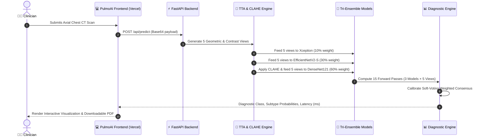

<div align="center">


# PulmoAI — Pulmonary AI Classification Engine
### *Clinical Deep Convolutional Tri-Ensemble for Automated Thoracic Lesion Diagnostics*

[](https://vercel.com)
[](https://huggingface.co/spaces/stellar-merge/pulmovision-api)
[](Lung-cancer-model-train/models/model_tracker.md)
[](Lung-cancer-model-train/models/model_tracker.md)
[](Lung-cancer-model-train/models/model_tracker.md)

<p align="center">
  <b>An end-to-end medical deep learning platform for automated detection, contrast enhancement, and multi-class histopathological classification of pulmonary lesions from axial chest CT scans.</b>
</p>

[🌐 Live Web Studio](#-production-deployment) • [⚡ System Architecture](#-system-architecture--pipelines) • [🚀 Quickstart](#-quickstart-clone--run-locally) • [📊 Clinical Benchmarks](#-clinical-benchmarks--validation) • [📁 Directory Index](#-repository-structure--quick-links)

---

</div>

## 🛠️ Core Technology Stack

PulmoAI unites modern cloud-native web engineering with clinical-grade computer vision and distributed model inference:

<div align="center">

| Domain | Technologies & Frameworks |
| :--- | :--- |
| **Frontend Clinical Studio** | [](https://nextjs.org/) [](https://react.dev/) [](https://www.typescriptlang.org/) [](https://tailwindcss.com/) [](https://lucide.dev/) |
| **Deep Learning & Imaging** | [](https://tensorflow.org/) [](https://keras.io/) [](https://opencv.org/) [](https://scikit-learn.org/) |
| **Inference & Backend** | [](https://python.org/) [](https://fastapi.tiangolo.com/) [](https://www.uvicorn.org/) [](https://gradio.app/) [](https://www.docker.com/) |
| **Cloud & Hosting** | [](https://vercel.com/) [](https://huggingface.co/) [](https://github.com/astral-sh/uv) |

</div>

---

## 📑 Repository Structure & Quick Links

Jump directly to dedicated subsystems and implementations:

```text
PulmoAI/
├── 🌐 frontend/                   # Clinical Next.js 16 Web Application (Deployed on Vercel)
│   ├── src/app/                   # App Router views (Studio, Pathology, Benchmarks, Architecture)
│   ├── src/components/            # Medical components (DiagnosticStudio, Radar, Consensus)
│   └── src/app/api/predict/       # Secure proxy route with automatic Python backend failover
│
├── ⚡ backend/                    # High-Performance Inference API (FastAPI + Hugging Face Spaces)
│   ├── api_server.py              # Production ASGI FastAPI inference server (Port 8001)
│   ├── inference.py               # Standalone CLI & diagnostic chart generator
│   ├── ensemble_pipeline.py       # Full 315-patient benchmark & confusion matrix generator
│   └── requirements.txt           # Python backend dependencies
│
├── 🧠 Lung-cancer-model-train/    # Model Training Pipelines & Research Notebooks
│   ├── train_densenet.py          # DenseNet121 + CLAHE contrast optimization pipeline
│   ├── train_efficientnet.py      # EfficientNetV2-S multi-scale training pipeline
│   ├── train.py                   # Xception two-stage transfer learning pipeline
│   ├── train.ipynb                # Interactive exploratory data analysis & training notebook
│   └── models/                    # Trained .h5 model checkpoints & performance tracker
│
└── 📄 docs/                       # Research Papers, Clinical Reports, and Presentations
    ├── Pulmo AI — Precision Clinical Thoracic Oncology.pdf
    ├── CRSP_Limitations_and_Solutions.pptx
    ├── report.md                  # Comprehensive clinical audit & safety report
    └── assets/                    # Official identity assets and logos
```

* 🔗 **[Explore Frontend Documentation →](frontend/README.md)**
* 🔗 **[Explore Backend & API Documentation →](backend/README.md)**
* 🔗 **[View Clinical Model Tracker & Metrics →](Lung-cancer-model-train/models/model_tracker.md)**
* 🔗 **[Read Full Clinical Audit Report →](docs/report.md)**

---

## 🏗️ System Architecture & Pipelines

PulmoAI implements a decoupled, high-resilience architecture where an edge-optimized Next.js frontend interfaces with a high-throughput Python inference engine driving the **Tri-Ensemble Neural Pipeline**.

### 1. End-to-End Clinical System Flow

```mermaid
flowchart TD
    classDef client fill:#0f172a,stroke:#38bdf8,stroke-width:2px,color:#f8fafc;
    classDef edge fill:#1e293b,stroke:#818cf8,stroke-width:2px,color:#f8fafc;
    classDef api fill:#0f766e,stroke:#2dd4bf,stroke-width:2px,color:#f8fafc;
    classDef prep fill:#1e1b4b,stroke:#a855f7,stroke-width:2px,color:#f8fafc;
    classDef models fill:#701a75,stroke:#f472b6,stroke-width:2px,color:#f8fafc;
    classDef consensus fill:#064e3b,stroke:#34d399,stroke-width:2px,color:#f8fafc;

    User(["🧑‍⚕️ Radiologist / Clinician"]):::client -->|Uploads DICOM / PNG Scan| UI["🌐 PulmoAI Web Studio (Next.js 16 on Vercel)"]:::edge
    UI -->|Next.js Proxy API /api/predict| Gateway["⚡ FastAPI Server / Hugging Face Spaces"]:::api
    
    subgraph Preprocessing["🔬 Preprocessing & Test-Time Augmentation (TTA)"]
        Gateway --> CLAHE["CLAHE Contrast Adaptation (LAB L-Channel Clip=2.0)"]:::prep
        Gateway --> TTA["5-View TTA Engine (Raw, Flip, Zoom 90%, Contrast ±15%)"]:::prep
    end

    subgraph Ensemble["🧠 Deep Convolutional Tri-Ensemble"]
        TTA -->|Rescaled [0, 1]| Xception["Xception Backbone (Weight: 10%)"]:::models
        TTA -->|Raw [0, 255]| EffNet["EfficientNetV2-S Backbone (Weight: 30%)"]:::models
        CLAHE -->|CLAHE Normalized| DenseNet["DenseNet121 Backbone (Weight: 60%)"]:::models
    end

    Xception --> SoftVoting["🗳️ Soft-Voting Consensus Aggregator"]:::consensus
    EffNet --> SoftVoting
    DenseNet --> SoftVoting

    SoftVoting --> Response["📊 Probabilistic Diagnosis + Confidence Metrics"]:::consensus
    Response -->|JSON Payload| UI
    UI --> Visual["📈 Diagnostic Radar & Histopathology Report Display"]:::edge
```

---

### 2. Deep Learning Tri-Ensemble Architecture

PulmoAI fuses three distinct inductive biases to eliminate single-architecture weaknesses:



#### Why the Tri-Ensemble Outperforms Single Models:
1. **DenseNet121 + CLAHE (60% Weight)**: Standard 8-bit CT exports often suffer from washed-out grey tones. By applying **Contrast-Limited Adaptive Histogram Equalization (CLAHE)** in the LAB luminance space and running through dense feature concatenation, low-level radiographic textures (such as ground-glass opacities and spiculation margins) are preserved without signal loss.
2. **EfficientNetV2-S (30% Weight)**: Employs progressive regularized convolutions to model multi-scale spatial features across macroscopic lung lobes and localized nodule boundaries.
3. **Xception (10% Weight)**: Utilizes depthwise separable convolutions to decouple cross-channel correlations from spatial correlations.
4. **5-View Test-Time Augmentation (TTA)**: Evaluates the original scan, horizontal mirror flip, 90% center zoom, +15% contrast boost, and -15% contrast soften to eliminate orientation and exposure artifacts.

---

## 🔬 The 4 Diagnostic Categories

PulmoAI accurately discriminates between four mutually exclusive thoracic classes:

| Class | Type | Clinical Presentation on CT | Test Recall | Test Precision |
| :--- | :--- | :--- | :---: | :---: |
| **Normal** | Healthy Parenchyma | Clear bilateral lung fields, intact vascular trees, sharp pleural margins. | **98.15%** | **100.00%** |
| **Adenocarcinoma** | NSCLC (Peripheral) | Subsolid nodules, ground-glass opacities, or irregular lesions with spiculation. | **86.67%** | **90.43%** |
| **Squamous Cell** | NSCLC (Central Airway) | Hilar or peribronchial cavitary masses, bronchial obstruction, atelectasis. | **92.22%** | **85.57%** |
| **Large Cell** | NSCLC (Undifferentiated) | Bulky, rapidly expanding peripheral or central lesions prone to central necrosis. | **86.27%** | **88.00%** |

---

## 📊 Clinical Benchmarks & Validation

Evaluated on **315 independent patient chest CT scans** from the Kaggle benchmark dataset (held out completely from training):

<div align="center">

| Metric | Score | Clinical Impact |
| :--- | :---: | :--- |
| **Overall Test Accuracy** | **90.16%** | **284 / 315 scans correctly classified** across 4 categories |
| **Cancer Sensitivity (Recall)** | **99.62%** | **260 / 261 cancer cases accurately detected** |
| **False Normal Calls** | **0 (Zero)** | **Zero malignant scans misdiagnosed as Healthy** |
| **Healthy Specificity** | **98.15%** | **53 / 54 healthy scans identified** with 100% precision |
| **Macro F1-Score** | **90.87%** | Balanced performance across all pathological subtypes |

</div>

### Confusion Matrix (315 Independent Patient Scans)

```text
                        Predicted
Actual               Adeno   Large   Normal  Squamous   |  Recall
--------------------------------------------------------+---------
Adenocarcinoma        104       5       0        11     |  86.67%  (104/120)
Large Cell              4      44       0         3     |  86.27%  (44/51)
Normal (Healthy)        0       1      53         0     |  98.15%  (53/54)
Squamous Cell           7       0       0        83     |  92.22%  (83/90)
--------------------------------------------------------+---------
Precision:          90.43%  88.00% 100.00%   85.57%    |  Overall Acc: 90.16%
```

---

## 🚀 Quickstart: Clone & Run Locally

Follow these steps to set up the full PulmoAI platform on your local workstation.

### 1. Clone the Repository

```bash
# Clone via HTTPS
git clone https://github.com/soubh2ik-source/Tech-Arch-Warriors.git
cd Tech-Arch-Warriors
```

---

### 2. Run the Backend Inference Server (FastAPI)

The backend provides the REST inference endpoint (`/api/predict` or `/predict`) and loads the trained `.h5` model weights (automatically downloading missing weights from Hugging Face Hub if needed).

```bash
# 1. Navigate to the backend directory
cd backend

# 2. Create and activate a Python 3.10 virtual environment
# Using Conda:
conda create -n pulmoai python=3.10 -y
conda activate pulmoai

# Or using uv / venv:
python -m venv .venv
# On Windows:
.venv\Scripts\activate
# On Linux/macOS:
source .venv/bin/activate

# 3. Install dependencies
pip install -r requirements.txt

# 4. Start the FastAPI local server on port 8001
python api_server.py
```

> **Note**: The backend will be live at `http://localhost:8001`. You can test health via `http://localhost:8001/health`.

---

### 3. Run the Clinical Frontend Application (Next.js)

The frontend is a modern Next.js 16 application with dark clinical aesthetics, interactive radar charts, and DICOM/scan uploaders.

Open a new terminal window:

```bash
# 1. Navigate to the frontend directory
cd frontend

# 2. Install Node dependencies
npm install

# 3. Configure the local backend connection (Optional)
# By default, frontend connects to local backend on port 8001 with automatic cloud failover.
# To explicitly point to your local server:
# Create a .env.local file:
# echo PYTHON_API_URL=http://localhost:8001 > .env.local

# 4. Launch development server
npm run dev
```

> **Open in Browser**: Visit **`http://localhost:3000`** to access the live PulmoAI Diagnostic Studio.

---

### 4. Standalone CLI Inference (No UI Required)

To run immediate inference on any CT scan directly from your terminal:

```bash
# Drop your scan as test.jpg in the project root, or pass any image path:
python backend/inference.py "path/to/patient_scan.png"
```

The script prints the confidence breakdown and automatically exports a publication-ready diagnostic plot to `prediction_result.png`.

---

## 🌐 Production Deployment

PulmoAI is built for effortless production deployment using cloud-native microservices:

### 1. Frontend on Vercel
* The `frontend/` directory is configured for continuous deployment on **Vercel**.
* Uses Vercel Edge Runtime and Serverless API routes for low-latency worldwide delivery.
* Features automatic SSL, preview deployments, and zero cold starts.

### 2. Inference Engine on Hugging Face Spaces
* The backend is deployed as a Dockerized API container on **Hugging Face Spaces** (`stellar-merge/pulmovision-api`).
* Synchronized in one click using [`sync_space.py`](sync_space.py).

### 3. Model Weights Storage on Hugging Face Hub
* Pretrained `.h5` weights for all 3 neural architectures are hosted on the Hugging Face Model Hub (`stellar-merge/pulmovision-models`).
* Automatically fetched during cold-boot if local weights are not present.

---

## ⚙️ Hyperparameters & Training Specifications

| Parameter | Stage 1 (Head Adaptation) | Stage 2 (Backbone Fine-Tuning) |
| :--- | :--- | :--- |
| **Input Resolution** | `350 × 350 × 3` | `350 × 350 × 3` |
| **Batch Size** | `16` (`8` for Xception) | `16` (`8` for Xception) |
| **Optimizer** | Adam ($\beta_1=0.9, \beta_2=0.999$) | Adam ($\beta_1=0.9, \beta_2=0.999$) |
| **Learning Rate** | Initial $1.0 \times 10^{-3}$ | Fine-tuned $1.0 \times 10^{-5}$ |
| **LR Scheduler** | `ReduceLROnPlateau(patience=3, factor=0.5)` | `ReduceLROnPlateau(patience=3, factor=0.5)` |
| **Early Stopping** | `patience=6, restore_best_weights=True` | `patience=6, restore_best_weights=True` |
| **Contrast Pipeline** | CLAHE ($8 \times 8$ grid, clip limit = 2.0) | CLAHE ($8 \times 8$ grid, clip limit = 2.0) |
| **Class Balancing** | Scikit-Learn inverse-frequency weights | Scikit-Learn inverse-frequency weights |

---

## 👥 Contributors & Acknowledgements

* **Author / Maintainer**: [Tech Arch Warriors](https://github.com/soubh2ik-source)
* **Dataset**: [Chest CT-Scan Images Dataset](https://www.kaggle.com/datasets/mohamedhanyyy/chest-ctscan-images) by Mohamed Hany on Kaggle.
* **Clinical Documentation**: [Precision Thoracic Oncology Report](docs/report.md) & [Architecture Guidelines](docs/CRSP_Limitations_and_Solutions.pptx).

<div align="center">

---

*PulmoAI is intended for clinical decision support and investigational research. Always correlate algorithmic predictions with certified radiological review and histopathological confirmation.*

</div>
