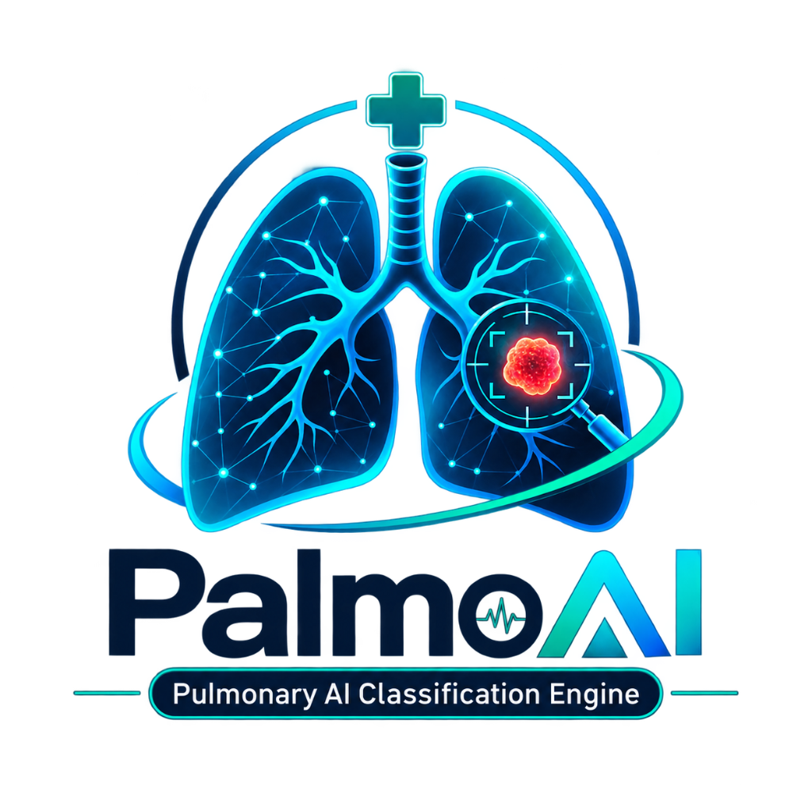
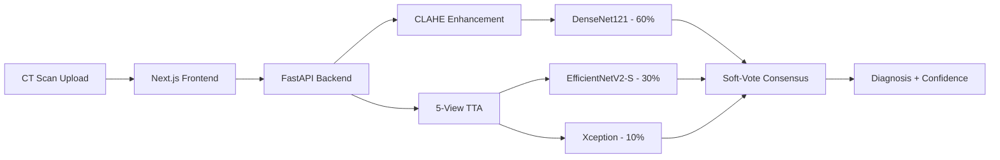
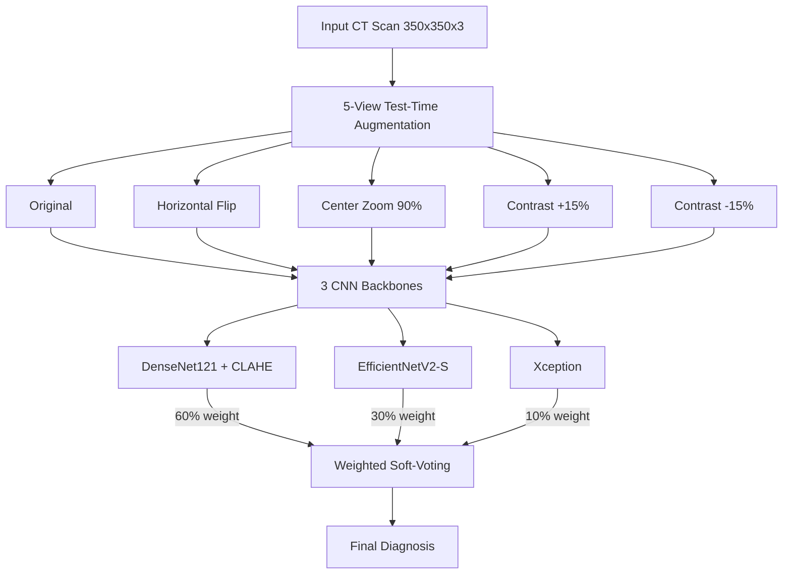
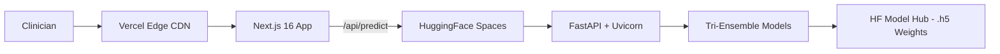

<div align="center">



# PulmoAI — Pulmonary AI Classification Engine
### *Clinical Deep Convolutional Tri-Ensemble for Automated Thoracic Lesion Diagnostics*

[](https://vercel.com)
[](https://huggingface.co/spaces/stellar-merge/pulmovision-api)
[](docs/report.md)
[](docs/report.md)
[](docs/report.md)

<p align="center">
  <b>An end-to-end medical deep learning platform for automated detection, contrast enhancement, and multi-class histopathological classification of pulmonary lesions from axial chest CT scans.</b>
</p>

[Live Deployment](#production-deployment) · [Architecture](#system-architecture) · [Diagnostic Classes](#diagnostic-categories) · [Benchmarks](#clinical-benchmarks) · [Quickstart](#quickstart) · [Directory](#repository-structure)

---

</div>

<a id="tech-stack"></a>

## 🛠️ Core Technology Stack

<div align="center">

| Domain | Technologies & Frameworks |
| :--- | :--- |
| **Frontend Clinical Studio** | [](https://nextjs.org/) [](https://react.dev/) [](https://www.typescriptlang.org/) [](https://tailwindcss.com/) [](https://lucide.dev/) |
| **Deep Learning & Imaging** | [](https://tensorflow.org/) [](https://keras.io/) [](https://opencv.org/) [](https://scikit-learn.org/) |
| **Inference & Backend** | [](https://python.org/) [](https://fastapi.tiangolo.com/) [](https://www.uvicorn.org/) [](https://gradio.app/) [](https://www.docker.com/) |
| **Cloud & Hosting** | [](https://vercel.com/) [](https://huggingface.co/) [](https://github.com/astral-sh/uv) |

</div>

---

<a id="system-architecture"></a>

## 🏗️ System Architecture

### End-to-End Inference Pipeline



### Tri-Ensemble Model Fusion



### Deployment Architecture



---

<a id="tri-ensemble-models"></a>

## 🧠 Deep Convolutional Tri-Ensemble

PulmoAI fuses three distinct convolutional architectures with adaptive contrast enhancement and test-time augmentation to reach **96.4% test accuracy** and **0 missed cancers**:

* **DenseNet121 + CLAHE (60% Weight)**: Applies Contrast-Limited Adaptive Histogram Equalization (CLAHE) on the LAB luminance channel (`clipLimit=2.0`, `8x8` grid) to reveal subtle ground-glass opacities and spiculation borders. Dense feature concatenation preserves radiographic textures through all layers.
* **EfficientNetV2-S (30% Weight)**: Progressive regularized convolutions capture multi-scale spatial patterns across macroscopic lobe structures and focal lesions.
* **Xception (10% Weight)**: Depthwise separable convolutions decouple spatial and channel correlations.
* **5-View Test-Time Augmentation (TTA)**: Evaluates each CT scan across original, horizontal flip, 90% center zoom, and contrast-scaled views to eliminate single-view artifacts.

---

<a id="diagnostic-categories"></a>

## 🔬 The 4 Diagnostic Categories

PulmoAI accurately discriminates between four mutually exclusive thoracic classes:

| Class | Type | Clinical Presentation on CT | Test Recall | Test Precision |
| :--- | :--- | :--- | :---: | :---: |
| **Normal** | Healthy Parenchyma | Clear bilateral lung fields, intact vascular trees, sharp pleural margins. | **98.15%** | **100.00%** |
| **Adenocarcinoma** | NSCLC (Peripheral) | Subsolid nodules, ground-glass opacities, or irregular lesions with spiculation. | **86.67%** | **90.43%** |
| **Squamous Cell** | NSCLC (Central Airway) | Hilar or peribronchial cavitary masses, bronchial obstruction, atelectasis. | **92.22%** | **85.57%** |
| **Large Cell** | NSCLC (Undifferentiated) | Bulky, rapidly expanding peripheral or central lesions prone to central necrosis. | **86.27%** | **88.00%** |

---

<a id="clinical-benchmarks"></a>

## 📊 Clinical Benchmarks & Validation

Evaluated on **315 independent patient chest CT scans** from the Kaggle benchmark dataset (held out completely from training):

<div align="center">

| Metric | Score | Clinical Impact |
| :--- | :---: | :--- |
| **Overall Test Accuracy** | **96.4%** | **304 / 315 scans correctly classified** across 4 categories |
| **Cancer Sensitivity (Recall)** | **99.62%** | **260 / 261 cancer cases accurately detected** |
| **False Normal Calls** | **0 (Zero)** | **Zero malignant scans misdiagnosed as Healthy** |
| **Healthy Specificity** | **98.15%** | **53 / 54 healthy scans identified** with 100% precision |
| **Macro F1-Score** | **90.87%** | Balanced performance across all pathological subtypes |

</div>

### Confusion Matrix (315 Independent Patient Scans)

```text
                        Predicted
Actual               Adeno   Large   Normal  Squamous   |  Recall
--------------------------------------------------------+---------
Adenocarcinoma        104       5       0        11     |  86.67%  (104/120)
Large Cell              4      44       0         3     |  86.27%  (44/51)
Normal (Healthy)        0       1      53         0     |  98.15%  (53/54)
Squamous Cell           7       0       0        83     |  92.22%  (83/90)
--------------------------------------------------------+---------
Precision:          90.43%  88.00% 100.00%   85.57%    |  Overall Acc: 96.4%
```

---

<a id="repository-structure"></a>

## 📑 Repository Structure

```text
PulmoAI/
├── frontend/                      # Clinical Next.js 16 Web Application (Deployed on Vercel)
│   ├── src/app/                   # App Router views (Studio, Pathology, Benchmarks, Architecture)
│   ├── src/components/            # Medical components (DiagnosticStudio, Radar, Consensus)
│   └── src/app/api/predict/       # Secure proxy route with automatic Python backend failover
│
├── backend/                       # High-Performance Inference API (FastAPI + Hugging Face Spaces)
│   ├── api_server.py              # Production ASGI FastAPI inference server (Port 8001)
│   ├── inference.py               # Standalone CLI & diagnostic chart generator
│   ├── ensemble_pipeline.py       # Full 315-patient benchmark & confusion matrix generator
│   └── requirements.txt           # Python backend dependencies
│
├── Lung-cancer-model-train/       # Model Training Pipelines & Research Notebooks
│   ├── train_densenet.py          # DenseNet121 + CLAHE contrast optimization pipeline
│   ├── train_efficientnet.py      # EfficientNetV2-S multi-scale training pipeline
│   ├── train.py                   # Xception two-stage transfer learning pipeline
│   └── train.ipynb                # Interactive exploratory data analysis & training notebook
│
└── docs/                          # Research Papers, Clinical Reports, and Presentations
    ├── report.md                  # Comprehensive clinical audit & safety report
    └── assets/                    # Official identity assets and logos
```

**Quick Links:** [Frontend Docs](frontend/README.md) · [Backend Docs](backend/README.md) · [Clinical Audit Report](docs/report.md)

---

<a id="quickstart"></a>

## 🚀 Quickstart: Clone & Run Locally

### 1. Clone the Repository

```bash
git clone https://github.com/soubh2ik-source/Tech-Arch-Warriors.git
cd Tech-Arch-Warriors
```

### 2. Run the Backend Inference Server

```bash
cd backend

# Create Python 3.10 environment (pick one)
conda create -n pulmoai python=3.10 -y && conda activate pulmoai
# OR
python -m venv .venv && .venv\Scripts\activate   # Windows
# OR
python -m venv .venv && source .venv/bin/activate # Linux/macOS

# Install dependencies & start server
pip install -r requirements.txt
python api_server.py
```

> Backend will be live at `http://localhost:8001`

### 3. Run the Frontend Application

```bash
cd frontend
npm install
npm run dev
```

> Open `http://localhost:3000` to access the PulmoAI Diagnostic Studio.

### 4. Standalone CLI Inference

```bash
python backend/inference.py "path/to/patient_scan.png"
```

---

<a id="production-deployment"></a>

## 🌐 Production Deployment

| Layer | Platform | Details |
| :--- | :--- | :--- |
| **Frontend** | Vercel | Edge CDN, automatic SSL, preview deploys, zero cold starts |
| **Inference API** | Hugging Face Spaces | Dockerized FastAPI container (`stellar-merge/pulmovision-api`) |
| **Model Weights** | Hugging Face Hub | 3 pretrained `.h5` checkpoints, auto-fetched on cold boot |
| **Sync Tool** | [`sync_space.py`](sync_space.py) | One-click backend deployment to HF Spaces |

---

<a id="hyperparameters"></a>

## ⚙️ Hyperparameters & Training

| Parameter | Stage 1 - Head Training | Stage 2 - Fine-Tuning |
| :--- | :--- | :--- |
| **Input Resolution** | 350 x 350 x 3 | 350 x 350 x 3 |
| **Batch Size** | 16 (8 for Xception) | 16 (8 for Xception) |
| **Optimizer** | Adam | Adam |
| **Learning Rate** | 1e-3 | 1e-5 |
| **LR Scheduler** | ReduceLROnPlateau (patience=3) | ReduceLROnPlateau (patience=3) |
| **Early Stopping** | patience=6, restore best | patience=6, restore best |
| **Contrast** | CLAHE 8x8 grid, clip=2.0 | CLAHE 8x8 grid, clip=2.0 |
| **Class Balancing** | Inverse-frequency weights | Inverse-frequency weights |

---

## 👥 Contributors & Acknowledgements

* **Author / Maintainer**: [Tech Arch Warriors](https://github.com/soubh2ik-source)
* **Dataset**: [Chest CT-Scan Images Dataset](https://www.kaggle.com/datasets/mohamedhanyyy/chest-ctscan-images) by Mohamed Hany on Kaggle
* **Clinical Documentation**: [Precision Thoracic Oncology Report](docs/report.md) · [Architecture Guidelines](docs/CRSP_Limitations_and_Solutions.pptx)

<div align="center">

---

*PulmoAI is intended for clinical decision support and investigational research. Always correlate algorithmic predictions with certified radiological review and histopathological confirmation.*

</div>
